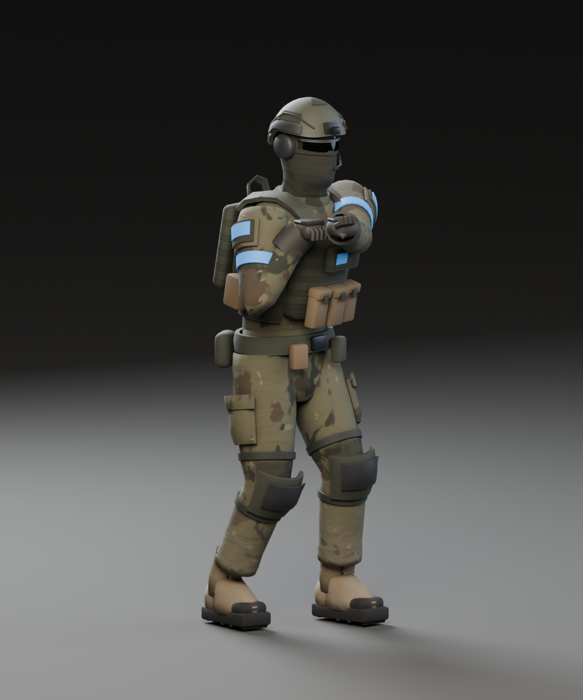
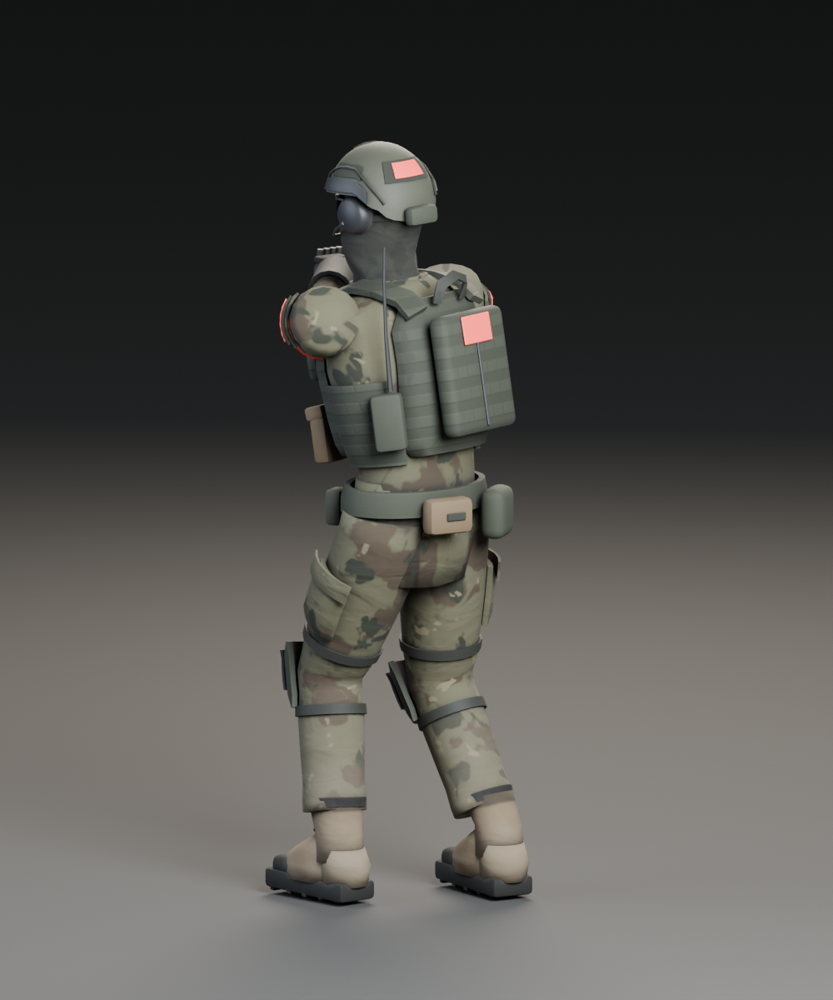
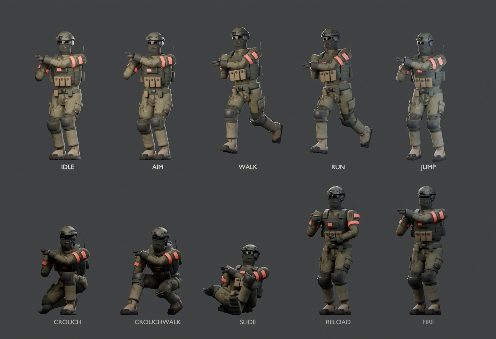
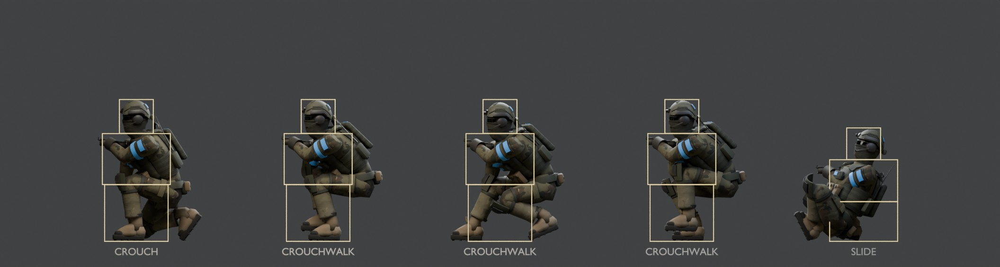
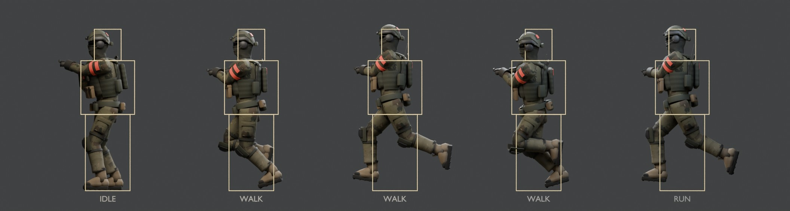

# Operator character art

The operator is the soldier you see when you look at other players in the first-person overhaul.
It replaces the bright armoured scout with dark modern military gear. It keeps the scout's
skeleton and gameplay animations, so the code that drives the scout drives the operator, and it
adds three new animations: crouch, crouch walk and slide. Its poses are fitted to the shared hit
boxes, so a shot at what you see lands where the server checks hits.

Everything in the model is original Kannon work: the gear shapes, the four-tone camouflage, the
colours and the new animations. Nothing is copied from a game, a brand or a real army, and no
textures or models were downloaded. The only outside material is the scout's existing walk and run
leg motion, which comes from the CMU motion capture database (see [Credits](#credits)).

| Front, friendly blue | Back, enemy red |
| --- | --- |
|  |  |







These are Blender studio renders of the exported pose data, not browser captures. The thin outlines
are the shared hit boxes for each pose.

## What it looks like

- **Head.** A high-cut helmet in dark olive paint with side rails, a front mount plate, hook-and-loop
  patches, a counterweight pouch and two bungee cords. A dark knit wrap is pulled up over the nose,
  with wraparound dark glasses and a headset with a boom microphone. No face is shown.
- **Plate carrier.** Ranger green, shaped to the chest and back, with 25 mm webbing rows, a side
  cummerbund, padded shoulder straps, three coyote magazine pouches with closed flaps, an admin
  pouch, a flat back panel with a zip, a radio with an aerial and a drag handle.
- **Clothes.** Combat shirt and trousers in an original four-tone camouflage, a shirt collar, knee
  pads, cargo pockets, a padded belt with pouches, dark gloves with knuckle guards and coyote boots
  with dark soles. Lower legs and boots carry a little street dust.
- **Team colour.** `PlayerAccent` covers both armbands, both shoulder patches, a chest patch, a back
  patch and a helmet patch, so a player's team shows from every side and from first-person range.

## Fitted to the hit boxes

The server checks hits against three boxes per posture (`hitboxes` in `shared/physics.ts`): head,
torso and legs, centred on the player and the same from every side. The generator reads the posture
heights from that file, and the validator imports the live module, so the art follows the shared
rules.

- **Crouch and crouch walk.** The helmet top stays under the 1.25 m crouch height, the head sits over
  the player (skull centre 1.06 to 1.09 m), and the glasses sit 3 to 5 cm under the 1.12 m camera.
  The crouch kneels on the right knee and sits back toward the right heel. The crouch walk is a deep,
  forward-leaning walk with the hips back and the knees clear of the floor.
- **Slide.** The helmet stays under the 1.0 m slide height. The operator leans back on the hips with
  both knees bent, so the boots stay within 0.67 m of the player (the old pose reached 0.99 m) and
  cannot show through a 0.28 m wall. The glasses sit 5 cm under the 0.92 m camera: the slide's 1.0 m
  top leaves only 8 cm over its camera, and a helmeted head needs about 15 cm.
- **Walk and run.** The scout's walk and run leaned the upper body about 23 degrees forward, carrying
  the head 27 to 33 cm ahead of the player, outside the head box, so a shot at a runner's head missed.
  The upper body is now upright with the head over the player like Idle's. The hips and legs are the
  scout's captured motion, sample for sample. The capture bobs the hips 6 cm above Idle's at the top
  of each stride, so for 42-46% of the stride the helmet top rises up to 5.4 cm over the 1.8 m
  standing box. The middle of the head is always inside it.
- **Weapon hands.** In every clip except Reload, the left hand keeps its grip on the weapon: within
  1.1 mm of its rest offset from `weapon_socket`, with the elbow bent (at most 149 degrees, as in
  Idle).
  The low poses carry the weapon 7 cm closer to the chest than Idle, which keeps the hands inside the
  torso box.

## Files

| Path | What it is |
| --- | --- |
| `scripts/blender/generate_operator.py` | Builds the model in Blender from `art/source/scout.blend`, re-poses Walk/Run, authors the new clips, bakes the atlas, exports, renders previews |
| `scripts/blender/finish_operator.mjs` | Compresses the atlas to KTX2 and writes the game model |
| `scripts/blender/validate_operator.mjs` | Checks the game model against the contract below and samples every clip |
| `public/models/operator-v1.glb` | The game model (`ARENA_ASSETS.character`) |
| `public/models/operator-motion-NOTICE.txt` | Public credit and terms for the CMU-derived walk and run |
| `art/source/operator.blend` | Editable Blender source (procedural materials, before baking) |
| `art/source/operator-*.png`, `operator-*.jpg` | Review renders |
| `art/source/operator-manifest.json` | Generator report: counts, clips, socket, pose and fit audits, bake settings |
| `art/source/operator-v1-manifest.json` | Finish report: size, SHA-256, texture sizes |
| `art/source/operator-export-review.json` | Validator report |

## Rebuild

From the repository root (Blender 5.2 and KTX-Software; see `scripts/blender/run_blender.mjs` and
`KTX_BIN`):

```sh
node scripts/blender/run_blender.mjs --python scripts/blender/generate_operator.py
node scripts/blender/finish_operator.mjs
node scripts/blender/validate_operator.mjs
```

The generator takes about two minutes on the desktop CPU. It writes the baked atlas PNGs and the
raw GLB to `<system temp>/kannon-operator` (`--work` changes that), and the editable source,
previews and manifest to `art/source`. Useful options: `--stage poses` authors the clips, prints the
fit audit and renders side views with the hit boxes in seconds (for tuning poses); `--stage preview`
renders the unbaked look; `--size`, `--bake-samples`, `--ao-samples` and `--render-samples` trade
quality for time. The finish step defaults to the same temporary folder (`--in`, `--out`,
`--normal uastc|etc1s`).

## Runtime contract (for the client)

- **Skeleton.** `ScoutRig` with the 18 scout bones, names unchanged: `root, pelvis, spine, chest,
  neck, head, upper_arm_l, forearm_l, hand_l, upper_arm_r, forearm_r, hand_r, thigh_l, shin_l,
  foot_l, thigh_r, shin_r, foot_r`. The rest pose and inverse bind matrices equal the scout's
  (checked to 1e-5).
- **Mesh.** One skinned mesh, `scout_body`, with three materials: `ScoutSurface` (the gear atlas),
  `PlayerAccent` and `Visor` (the glasses lens). The names are kept from the scout so
  `CharacterImpact` and `BlenderCharacter` keep working. Boot soles are weighted 100% to the foot
  bones, which `LegContact` needs. No weapon meshes, no muzzles, no `healing_item`.
- **Team colour.** Set the colour of the cloned `PlayerAccent` material, as `BlenderCharacter` does
  now. It is a plain colour with no texture.
- **Clips.** `Idle, Jump, Aim, Fire, Reload` have exactly the scout's samples. `Walk` and `Run` keep
  the scout's root, hip and leg samples exactly (so foot contact and `LegContact` are unchanged) with
  an upright upper body; reference speeds stay 6.5 and 9 m/s. `Heal` is gone. `Fire` and `Reload`
  still start from Idle's upper-body pose, so the existing additive playback works.
- **New clips.** All are full-body base poses, in place, holding the weapon level at chest height.
  - `Crouch`: a two-second breathing loop of a low kneel, left foot forward, right knee down.
  - `CrouchWalk`: a 16/30-second loop at a **2.6 m/s reference**. Play it at `speed / 2.6`
    (negative for backwards), like Walk (6.5) and Run (9). Exported at 120 Hz. Its feet are **in
    step with Walk and Run** at the same normalized time (within 0.02 of a cycle), so it can join
    them as a gait clip whose phase `CharacterBlend` shares during fades without scissoring the legs.
  - `Slide`: a one-second held pose, feet first and leaning back with the knees bent, with a small
    shudder. Loop it while the player slides.
  - Heights and hit boxes: see [Fitted to the hit boxes](#fitted-to-the-hit-boxes).
- **Weapon socket.** An empty `weapon_socket` under `hand_r` marks the right palm on the pistol
  grip. At rest it sits at (0.14, 1.39, -0.336) m with no rotation, so its axes match the weapon
  models: -Z along the barrel, +Y up. To hold a gun, add the weapon root to the socket and move it
  by minus its `grip_r` position. It follows `hand_r` through every clip, including recoil and
  reloads. The left wrist keeps a rifle fore-end grip in every clip except Reload: 11.4 cm ahead of
  the socket along the barrel, 4.5 cm to its left and 1.5 cm up (its palm about 15 cm ahead of the
  right palm). Pistols and other short weapons need their own support-hand placement at runtime.
- **Textures.** KTX2 (`KHR_texture_basisu`), so the loader needs `setKTX2Loader` as now. No meshopt
  or Draco. The root `extras.kannon` repeats the reference speeds and the socket convention.

## Checks

`node scripts/blender/validate_operator.mjs` checks the container, names, the clip list, the socket
position and axes, budgets (4 MB, 25,000 triangles, at most four material draws) and embedded KTX2
textures. It proves the rig, the five unchanged clips and the Walk/Run hip and leg tracks match
`public/models/scout.glb`, then plays every clip through Three's AnimationMixer on the CPU and
samples the real skinned vertices against the live `POSTURE_HEIGHT`, `EYE_HEIGHT` and `hitboxes`
from `shared/physics.ts` (imported through tsx):

- nothing visible rises above the posture's hit boxes (Walk/Run may rise up to 6 cm for the
  captured bob), and no part goes through the floor (Jump plays in the air and is exempt);
- the glasses sit between 6 cm under and 3 cm over the camera height (Walk/Run on average);
- the middle of the head stays inside the head box in every clip; in the low poses at least 85% of
  the helmet and head gear is inside a hit box at every moment, and in Walk/Run at least 65% on
  average over the stride (Idle: 67%);
- the low poses keep at least 70% of the body inside the hit boxes on average and two thirds at
  worst (they spread the legs on the floor, so they cannot match Idle's 81%; the reviewed poses kept
  53-58%), and stay within 0.70 m of the player;
- the left hand keeps its grip on the weapon, with a bent elbow, in every clip except Reload;
- CrouchWalk's feet step in phase with Walk and Run (correlation of fore-and-aft foot travel);
- boots never go below the floor, Walk, Run and CrouchWalk loop without seams (the loop boundary is
  no rougher than the clip's own 120 Hz keys) and with limited foot slip, and held feet do not slide.

It prints a fit table and lists every failure in one run, and writes
`art/source/operator-export-review.json`.

`scripts/blender/validate_glb.mjs` does not apply to this model: it requires the scout's weapons and
Heal clip, which the operator contract removes. (Its locomotion step also always reads
`public/models/scout.glb`, whatever `--glb` says.)

## Measurements

From `art/source/operator-export-review.json` for this build. "Before" is the first operator build,
reviewed on 2026-10-30.

| Measurement | Operator v1 | Before, or limit |
| --- | --- | --- |
| File size | 2,859,208 bytes (2.86 MB) | budget 4 MB |
| Triangles / exported vertices | 23,188 / 21,132 | budget 25,000 triangles |
| Material draws per player | 3 | |
| Gear atlas | colour 2048² ETC1S 479 kB, normal 1024² UASTC 770 kB, metal/roughness 1024² ETC1S 136 kB | |
| Clips identical to the scout | Idle, Jump, Aim, Fire, Reload: 54 channels each; Walk, Run: 24 root, hip and leg channels each (difference 0) | |
| Rest pose / inverse binds vs scout | 7e-7 / 0 | 1e-5 |
| Weapon socket at rest | (0.140, 1.390, -0.336) m, rotation error 1e-7 rad | |
| Helmet top, Crouch / CrouchWalk / Slide | 1.245 / 1.244 / 0.993 m | heights 1.25 / 1.25 / 1.0; before 1.333 / 1.372 / 1.057 |
| Glasses, Crouch / CrouchWalk / Slide | 1.09 / 1.07-1.09 / 0.87 m | cameras 1.12 / 1.12 / 0.92; before 1.19 / 1.20-1.23 / 0.89-0.90 |
| Head gear inside hit boxes, Crouch / CrouchWalk / Slide | 100% / 96% / 91% | before 37% / 24% / 83% |
| Head gear inside hit boxes, Walk / Run (stride average, worst) | 69%, 52% / 68%, 51% | before 0%; Idle 67% |
| Head centre from the player, Walk / Run | at most 0.13 m | head box half width 0.15; before 0.33 |
| Helmet top, Walk / Run | 1.854 / 1.853 m, over 1.8 m for 42% / 46% of the stride | before 1.80 (head 30 cm forward) |
| Body inside hit boxes, Crouch / CrouchWalk / Slide | 74% / 75% average (70% worst) / 72% | before 58% / 53% / 58%; Idle 81% |
| Farthest point from the player, Crouch / CrouchWalk / Slide | 0.66 / 0.67 / 0.67 m | limit 0.70; before 0.58 / 0.67 / 1.00 |
| Support hand off its grip (all clips but Reload) | at most 1.1 mm | limit 1 cm; before 1.9 / 2.7 / 13.8 cm in Crouch / CrouchWalk / Slide |
| Left elbow, Idle / low poses | 144-149 / 123-125 degrees | before 175 (locked) in the low poses |
| Lowest boot point, Walk / Run / CrouchWalk | 6.8 / 6.5 / 6.2 mm above the floor | must stay above -1 mm |
| Lowest body point, CrouchWalk | 6 mm above the floor | before -9 mm (knee pad) |
| Foot slip p95 in the 20 mm band, Walk / Run / CrouchWalk | 0.19 / 0.64 / 0.12 m/s | limits 0.6 / 1.0 / 0.35 |
| Loop velocity seam, Walk / Run / CrouchWalk | 0.99 / 1.58 / 1.23 m/s | own keys' 90th percentile 3.67 / 5.71 / 1.53 |
| CrouchWalk phase against Walk / Run | within 0.013 / 0.017 of a cycle | before 0.31 |

## Limits

- Skinning is mostly rigid with blended joints at the hips, knees, shoulders and elbows. Very deep
  bends pinch the trousers a little; the knee pads hide most of it.
- Ambient occlusion is baked on the rest pose, with arms raised for a rifle. It is short range (8 cm)
  so it darkens seams and pouch edges rather than casting arm shadows.
- The model's hands close around a rifle grip and fore-end. Weapons from `weapons-v1.glb` whose grips
  sit elsewhere will need the client to adjust the left hand.
- The slide is one held pose, not a full enter-and-exit animation; the client blends into it. It is
  compact on purpose, so it reads as a tucked slide rather than one with a long leg out in front.
- The running bob lifts the helmet a few centimetres over the standing hit box for part of each
  stride, and Idle's head leans 10 cm forward of the player (both inherited from the scout motion).
- These checks prove the asset, not how it looks in the browser at game distance or how it
  performs on a phone. Both need checking once the client loads it.

## Credits

The data used in this project was obtained from mocap.cs.cmu.edu. The database was created with
funding from NSF EIA-0196217.

The Walk and Run hip and leg motion derives from CMU subject 09, trial 01, frames 15 to 103,
retargeted to the scout skeleton (see [motion/cmu-09](../art/source/motion/cmu-09/CMU-USAGE-NOTICE.md)).
It is modified capture data, not CC0. It may be used in this game but must not be sold as motion
data or a converted animation pack. Their upright upper body is original Kannon work. The public
notice ships beside the model as `public/models/operator-motion-NOTICE.txt`, and the GLB's
`asset.copyright` carries the same credit. The scout's own notice,
`public/models/scout-motion-NOTICE.txt`, is unchanged.
