# Kannon Town v3 — checkpoint dressing and golden-hour light, October 30, 2026

Part of the first-person combat overhaul ([design](superpowers/specs/2026-10-30-first-person-combat-overhaul-design.md), section 6; [plan](superpowers/plans/2026-10-30-first-person-overhaul.md), workstream J). The street is the same street: every collision box, spawn, stair route, door and window is where it was, plus the eight new checkpoint cover boxes already frozen in `shared/map.ts`. This release gives those boxes real objects, re-dresses the town as a checkpoint after an evacuation, and re-bakes the light at golden hour.

## What changed

- **Checkpoint cover.** Six stacked sandbag walls (seven courses, three rows, a broken bond, every outer sack bulging 1.5 cm proud of its collision face) and two precast concrete barriers (two units per box, a jersey-style toe and slope, lifting loops, the weathered black-and-white Poly Haven barrier texture). A core of packed sacking fills each sandbag wall 2.5 cm inside its collision faces, and a filler that follows the concrete's profile a few centimetres in closes the 12 mm joint between each barrier's two units: no seam between sacks is deeper than the core, and nothing can be seen through the cover. The validator fires a ray every 5 cm at every exposed face and requires every one to meet the cover close to the collision face (see Verification).
- **Crate stacks.** The three prop cover boxes (the north delivery pile and the two back-yard covers) are stacks of olive ammunition crates that fill each box to within a centimetre of its faces: long crates break up the seams, a dark core closes the gaps between crates, canvas tarps drape over the tops and down the sides, a stack of spare traffic cones stands on the north crates and a spare tyre lies on each yard stack. v2's barrels, bags and boxes there left up to 40 cm of invisible collision; now no part of these boxes blocks a shot without something visible there.
- **Military cargo truck.** The box truck, in exactly its own boxes: olive cab and drop sides, a canvas cover where the box body was (sewn panels, straps, lashing rope, a rolled rear flap), a divided windscreen with wipers, round headlamps behind guard plates, bumper, tow hooks, mirrors and steps. Its old bright posts and lamp housings are dark.
- **Evacuation bus and a burnt-out car.** The school bus keeps its shape but its paint is faded and grimed toward the road. The north car burned out: charred and rusted body, smoke-blackened glass, a scorch mark spread around it and charred scrap on the road.
- **Dressing.** Plywood boarded over the ground-floor side windows and one upstairs window; concertina wire along the tops of the boundary fences; traffic cones by the barriers and the centre sandbags, and one knocked over by the burnt car; rubble and concrete chips, plaster and glazing-bar splinters under the broken and boarded windows, and spent cases behind the sandbag walls (all under 10 cm, so players walk over them); scorch marks, oil stains, tyre tracks and mud as ground decals; weathered, less saturated house paint and drier lawns; four distant smoke columns beyond the hills.
- **Breakables.** Six window panes in the upstairs street windows (`Breakable_Glass_0..5`), two of them already broken (a jagged hole with shards left in the frame; a shot knocks the rest out), and four terracotta pots with dead plants by the front doors and on the balconies (`Breakable_Pot_0..3`), each its own node and one draw call, listed in `ArenaWorld.breakables` for the effects workstream to shatter. They are cosmetic: shots and players pass through them, and the lower front windows (vault routes) have no glass. The pots bake in their own small lightmap and are invisible to the rest of the bake, so no baked shadow stays behind when one shatters; their shadow is real-time and leaves with them.
- **Golden hour.** The sun is now 21 degrees up in the west-south-west, warm (`#ffc98f`), and the houses' shadows reach across the street; cool sky light fills the shade; a warm haze softens the hills; clouds are lit from below. Interiors are dim evening rooms that are still easy to fight in.
- **Runtime light that matches the bake.** `src/game/Atmosphere.ts` holds the sun direction, colour and intensity, hemisphere, fog and exposure the bake was made for; the sky shader uses the same sun. Decals draw as multiply decals (they can only darken, and fog fades them out), smoke columns are unlit, window panes are see-through and reflect the street.
- **Real-time shadows that agree with the bake.** Only meshes whose shadows are not in the bake draw into the sun's shadow map: the pots and the grass cards. Glass, wire, decals, smoke and every lightmapped surface do not; this is decided per mesh, because meshes share materials. Each lightmap carries a *shade level* in its alpha channel: the share of the baked light that remains where the sun is blocked. A character's shadow takes the baked light down to that level and no further, so a character in baked shade or indoors throws no shadow at all, and a character in the sun throws a long shadow exactly as dark as the shade beside it. The wire and the grass cards, which are not baked, carry their sun visibility per vertex in their colour's alpha (measured against the town in Blender), so wire and grass in a house's shade get only sky light. Smoke and foliage sway from their world positions: the compressed meshes store positions in a unit box, so the first cut's sway barely moved.

## The calibration, and a correction to v2

Cycles bakes the diffuse light pass as irradiance divided by pi (the brightness of a white matte surface), while three.js lightmaps and lights are irradiance. v2 calibrated against a reference plane instead of stating the scale, and its sky ended up about three times stronger relative to the sun than intended, which is part of why v2 looked flat. v3 states the scale (`BAKE_TO_IRRADIANCE = pi`, `blenderToRuntime = SUN_INTENSITY / sun strength`), sets the sky so open sky gives 20 percent of the sun's irradiance, and records what it measured in `art/source/town-v3/town-v3-lightmaps.json`:

| Measured in the bake, three.js units | Value | Runtime |
| --- | --- | --- |
| Sun on a surface facing it | 5.27 / 3.06 / 1.44 (RGB) | `SUN_INTENSITY` 5.2 x `#ffc98f` = 5.20 / 3.04 / 1.43 |
| Open sky on an upward surface | 0.63 / 1.08 / 1.87 | hemisphere `#9ec8ff` x 1.4 plus the sky probe |
| Ground bounce on a downward surface | 0.26 / 0.20 / 0.18 | hemisphere ground `#746762` x 1.4 |
| Sunlit street, upward | 2.36 / 1.92 / 2.01 | (baked only) |

`tests/assets/town-v3-light.test.ts` fails if `Atmosphere.ts` and the bake drift apart: same sun direction and colour, the baked sun within 12 percent of the DirectionalLight, the hemisphere within the baked sky's range and hue, and a low western sun.

The shade level comes from a second bake of each atlas with the sun alone (no sky, no interior lights, no bounces). Its share of the full bake is written beside each atlas (`LM_*_sun.png`); `finish_town_v3.mjs` stores one minus that share as the lightmap's alpha, resizing colour and alpha separately (an alpha-aware resize would darken the colour where the alpha is low) and marking the lightmap `extras.shadeAlpha`. Stored this way round, a lightmap that lost its alpha reads 1 and nothing is removed. Older lightmaps without the mark (v2) keep the previous behaviour.

## Play and compare

Build the transcoder files once (`node scripts/build-ktx2-worker.mjs`), start the review page with `npm run graphics-test`, and open **http://127.0.0.1:5184/graphics-test.html?graphics=v3**. Before is Kannon Town v2 under its own exposure, fog and daylight; After is v3 under the golden-hour light. Both share the v3 sky dome. Add `&tier=phone` for the phone builds. New views: the checkpoint from both street ends, the cargo truck, the burnt-out car, a barrier, the back-yard sandbags and crates, the broken window, the long shadows across the street, and a player standing in the sun and in house shade. Walk around works with the keyboard and mouse, or on a touch screen with a stick, a look area and a jump button. To capture or measure without the game server, start only the page server (`node node_modules/vite/bin/vite.js --config vite.graphics.config.ts --port 5194 --strictPort`), run `node scripts/vehicle-test/capture-town-v3.mjs` or `node scripts/vehicle-test/measure-town-v3.mjs`, and stop the server afterwards.

Captures from the real renderer (Edge on this machine's integrated GPU, the pre-overhaul GameView, before the effects and grade workstreams land): [all pairs](../art/source/town-v3/captures/captures-sheet.jpg), with cameras and canvases in [captures.json](../art/source/town-v3/captures/captures.json).

| View | Before (v2) | After (v3) |
| --- | --- | --- |
| Checkpoint from the north end | 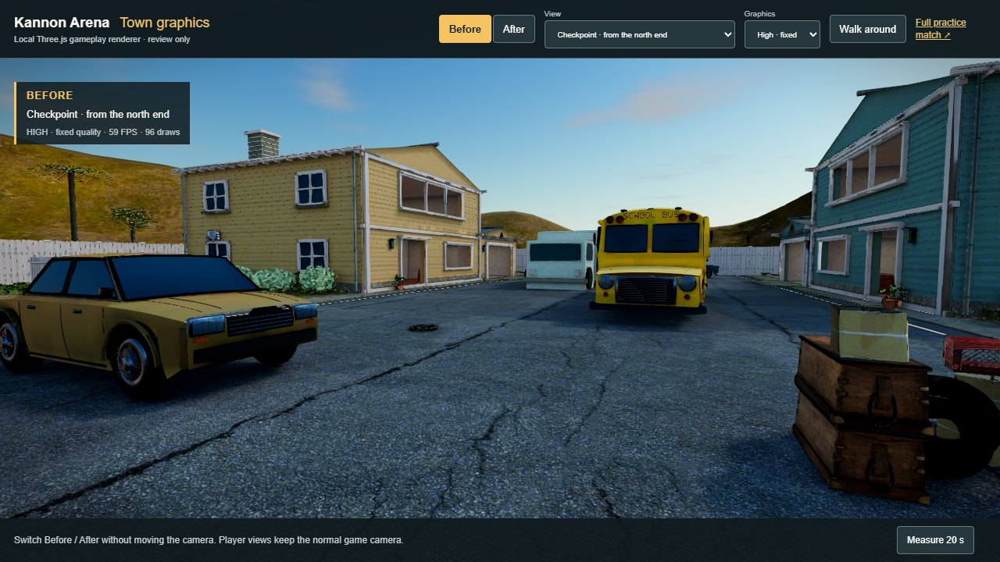 | 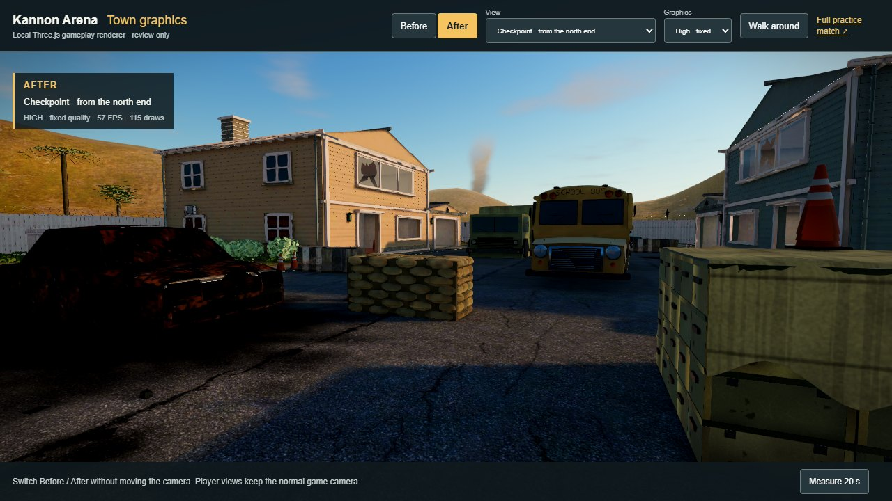 |
| Long shadows across the street | 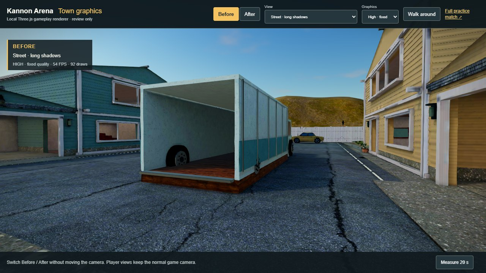 | 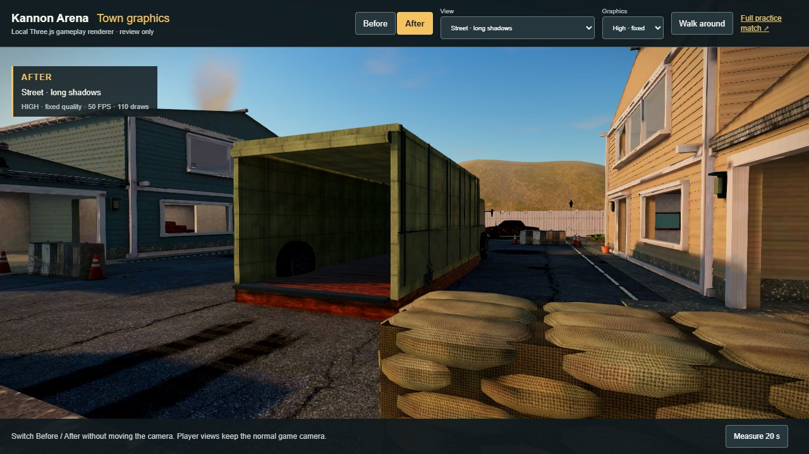 |
| Burnt-out car, wire and crates | 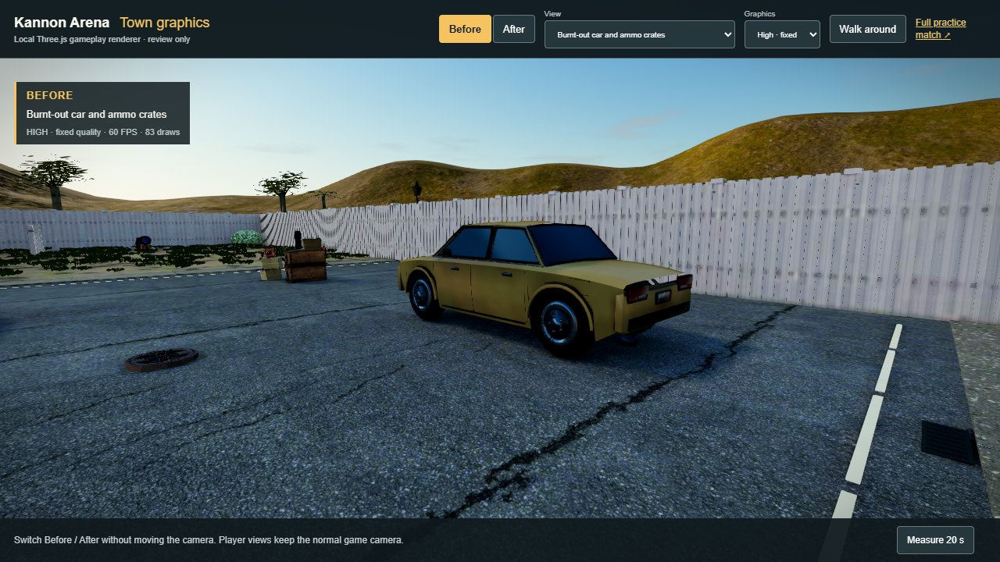 | 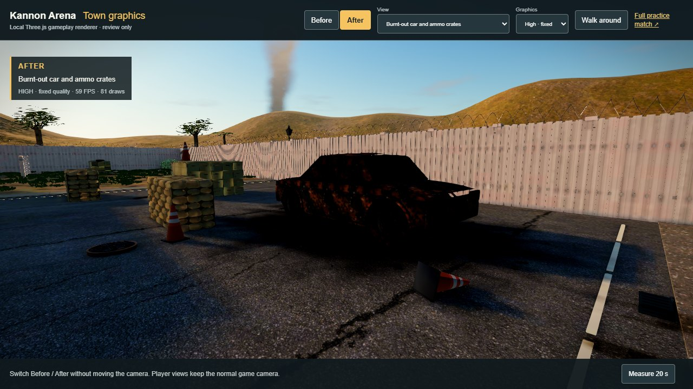 |
| Back-yard crate stack | 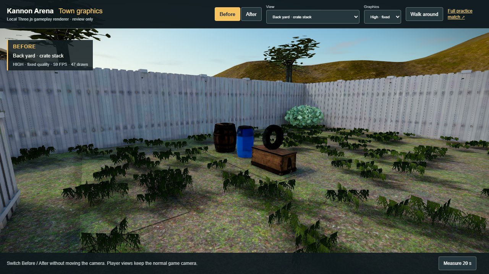 | 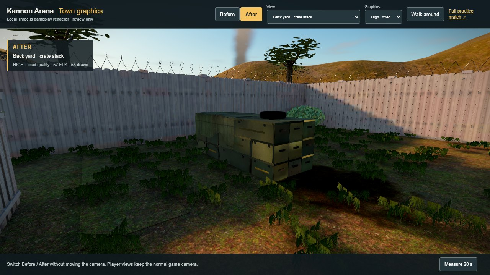 |
| A player in house shade: v2's shading darkens the shade under them, v3's leaves it alone | 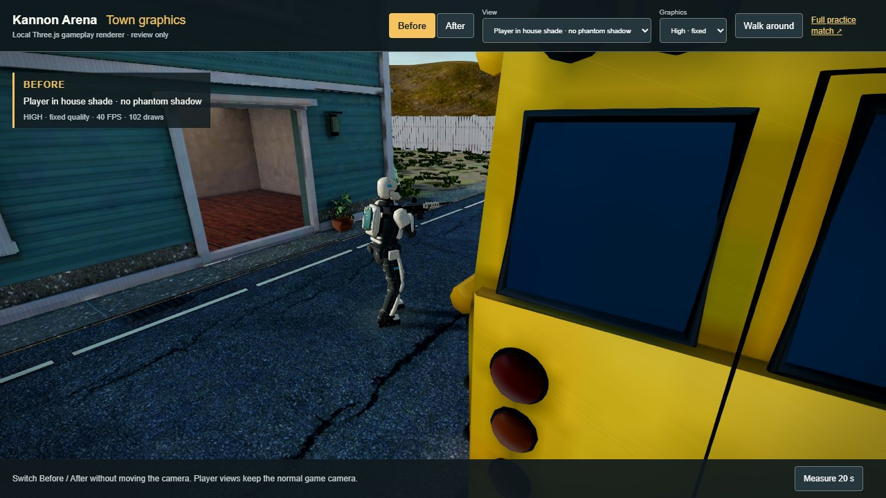 | 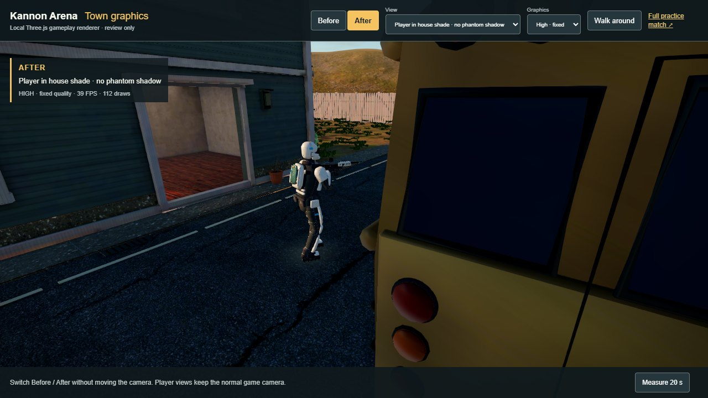 |
| Checkpoint, phone tier | 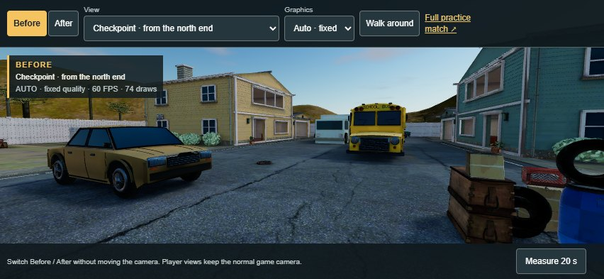 | 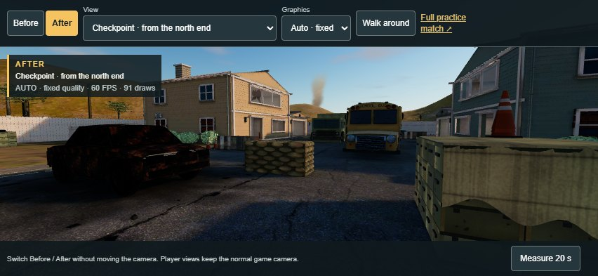 |

A check of the shadows themselves (the same views rendered with the sun's shadow map on and off): a player in the sun throws a long shadow that takes the street down to its baked shade level; a player in house shade changes nothing on the ground, where v2's shading drew a dark patch under them.

## Measured cost

| Model download | Kannon Town v2 | Kannon Town v3 |
| --- | ---: | ---: |
| Environment, full build, bytes | 25,468,864 | 25,302,388 |
| Environment, phone build, bytes | 12,399,132 | 13,396,220 |
| Triangles | 367,921 | 415,953 |
| Material primitives (draw calls) | 73 | 87 |
| KTX2 images | 140 | 132 |

Full-build SHA-256 `7e83a4005aae31913d1b78e4f6b013272e7e927b5272ba0279d7a582fc740478`, phone build `6b0295cf32ee7b85f6ea1511c792322d20c7e6b066916c46f3c64ad029d8265f`. The sandbag walls (432 sacks) and the wire add the most triangles; v2's delivery pile, yard barrels and bags and potted plants they replace give some back, for about 48,000 net. Fourteen more draw calls than v2: ten breakables (one each, so they can shatter separately), decals, smoke, wire, cones and the new material families, less five prop sets that left with v2's yard covers. The shade levels add about 470 KB to the full build's lightmaps and 170 KB to the phone build's; the prop texture sets that left with the yard covers pay for them.

Budgets (validator): full at most 30 MB, phone at most 14 MB, 470,000 triangles, 100 draw calls. The patterned sofa fabric (a 2k texture set used by one sofa) became a plain dusty cover to pay for the new textures; the v3 normal and roughness maps ship at 256 px on phones.

Frame times, Edge 152 on this machine's AMD integrated GPU, fixed views, 20-second samples after a 7-second warm-up, v2 / v3 / v2 brackets on one page ([raw report](../art/source/town-v3/town-v3-performance.json)):

| Configuration, view | FPS v2 / v3 | 95th-percentile ms v2 / v3 | Median GPU ms v2 / v3 | Draws v2 / v3 | Triangles drawn v2 / v3 |
| --- | ---: | ---: | ---: | ---: | ---: |
| Desktop High, bus | 59.8–59.9 / 58.2 | 16.8 / 16.8 | 15.4–15.7 / 16.3 | 95 / 114 | 357,828 / 396,684 |
| Desktop High, checkpoint | 59.9 / 59.9 | 16.8 / 16.8 | 15.0–15.2 / 14.9 | 96 / 115 | 362,964 / 417,952 |
| Phone tier, bus | 59.4–59.9 / 59.9 | 16.8 / 16.8 | 4.2 / 4.9 | 71 / 89 | 343,894 / 382,694 |
| Phone tier, checkpoint | 59.9 / 59.9 | 16.8 / 16.8 | 4.3 / 4.9 | 74 / 91 | 355,530 / 406,962 |

The phone tier holds the display's 60 Hz with about 0.6 ms more GPU time per frame than v2 (the lightmaps now carry an alpha channel, and the wire, grass and foliage do a little more work per vertex). On desktop High the bus view averaged 58.2 FPS against v2's 59.8 to 59.9 with the same 95th-percentile frame time: the integrated GPU is near its limit there (16.3 ms median), and other jobs were running on the machine. These use the pre-overhaul renderer without the first-person viewmodel, effects or the new grade, and phone means desktop touch emulation at DPR 1.

## Verification

- `node scripts/blender/validate_town_v3.mjs` decodes both shipped files and proves: a guide for every one of the 158 collision boxes at its exact position; v2's witness faces on every other non-vehicle box; for the eight checkpoint boxes, a ray every 5 cm over every exposed face (more than 3 cm from the face's edges, about 3,500 rays per sandbag wall) meeting the sandbags within 5.5 cm behind and 5 cm in front of the collision face, or the concrete within 6 cm behind and 4 cm in front, with no ray passing through, and no part of the cover more than 7 cm outside its box; the same grid over the three crate stacks meeting a crate, the tarp or what rests on top within 10 cm; doors, windows and the truck entrance open (breakables ignored, they shatter); six panes, two of them broken, and four pots as separate single-draw nodes; every lightmap carrying its shade level in a KTX2 alpha channel; smoke more than 120 m away; decals on the ground; decoration in walkable space only on the documented allowance (small street furniture such as cones, boarded windows flat to a wall, the pots); lightmaps on the second UV set; KTX2 only; the golden-hour calibration in the manifest; bytes, triangles and draw calls within budget.
- `npx tsx --test tests/client/lightmaps.test.ts tests/client/sun-visibility.test.ts tests/assets/*.test.ts`: lightmap reading and the shade-level shading; shadow casting decided per mesh, over hand-built cases and over the shipped files (only the pots and grass cards cast); the decal, smoke and glass materials; smoke sway in world metres at the shipped node scale; the wire's and grass cards' per-vertex sun visibility; sun visibility with the long golden-hour shadow across the street; the bake-to-runtime light agreement and the sun-share images; the review views standing clear of the collision map; and the shipped files' contract (guides for all 158 boxes, breakables, blended and unlit materials, budgets).

## Editable sources and provenance

Blender 5.2.1, Node.js 24+, KTX-Software 4.4 (`ktx` on PATH or `KTX_BIN`, default `C:\it\tools\ktx\bin`):

```powershell
node --import tsx scripts/blender/export_map.ts > art/source/town-v3/map.json
node scripts/blender/run_blender.mjs --python scripts/blender/generate_town_v3.py -- --stage all --samples 128 --atlas 2048
node scripts/blender/finish_town_v3.mjs --input art/source/town-v3/town-v3-raw.glb --lightmaps art/source/town-v3/town-v3-lightmaps.json --out public/models/environment-v3.glb --tier full --manifest art/source/town-v3/environment-v3-manifest.json
node scripts/blender/finish_town_v3.mjs --input art/source/town-v3/town-v3-raw.glb --lightmaps art/source/town-v3/town-v3-lightmaps.json --out public/models/environment-v3-phone.glb --tier phone --manifest art/source/town-v3/environment-v3-phone-manifest.json
node scripts/blender/validate_town_v3.mjs
node scripts/blender/run_blender.mjs --python scripts/blender/generate_town_v3.py -- --stage preview --views checkpoint,crates,broken,cones
```

`generate_town_v3.py` starts from `generate_town_v2.py` and the repository's own `kannon-town-graphics.blend`. The bake (each atlas twice: full light, then the sun alone) takes about ten minutes at 128 samples on this machine. `--stage shade` re-measures the wire's and grass cards' sun visibility in a baked working file without baking again. Working files (the Blender file, raw export, atlases, sun-share images, previews, generated textures) are regenerated under `art/source/town-v3/` and ignored by its own `.gitignore`; the map export, manifests, lightmap sidecar, captures and shipped GLBs are committed.

Third-party material: Poly Haven textures and models, CC0 1.0, listed in `art/source/town-v2/cc0-manifest.json` (no new downloads; the barrier uses the already-fetched `concrete_road_barrier` textures on original geometry). Sandbags, barriers' shape, the truck's canvas and fittings, crates, tarps, cones, rubble, wire, pots, broken panes, boards' layout, decals, smoke and every procedural texture (sacking, canvas, worn paint, fire damage, decals, smoke) are original to the script.

## Limitations

- The captures and measurements use the pre-overhaul third-person GameView, lit through the harness with the `Atmosphere.ts` values. The game itself shows this light only once GameView reads `SUN_COLOR`, `SUN_INTENSITY`, `HEMISPHERE`, `FOG` and `EXPOSURE` from `Atmosphere.ts`.
- Breakables are cosmetic. A player who vaults out through an upstairs pane before anyone shoots it passes through the glass.
- Glass, decals and smoke are not lightmapped. Wire and grass cards are lit per vertex, so their shade edges step from one vertex to the next rather than following a soft shadow line.
- Sandbags and crates are lumpy by nature. Within 3 cm of a face's edge, where the rounded sacks meet, the rendered surface can sit further in than the collision box's sharp corner.
- Traffic cones, like the trash cans, hydrants and benches, have no collision (the map's collision is frozen): players walk through them and shots pass through them.
- A character's shadow in the sun shows the bake's own sampling grain in the shade it leaves behind, as the baked shadows do.
- Golden hour leaves about two thirds of the central street in shade. Players there are lit by the cool sky; the effects and grade workstreams decide the final contrast.
- Phone means desktop Chromium touch emulation, not a physical iPhone.
