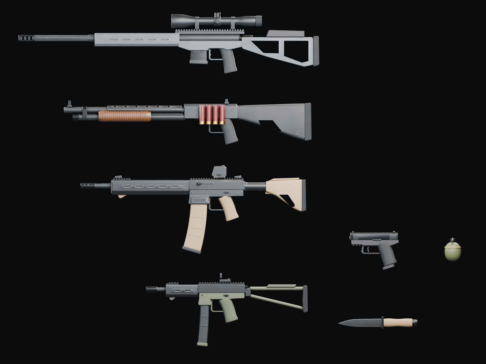
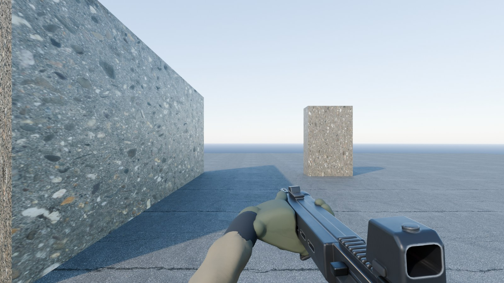
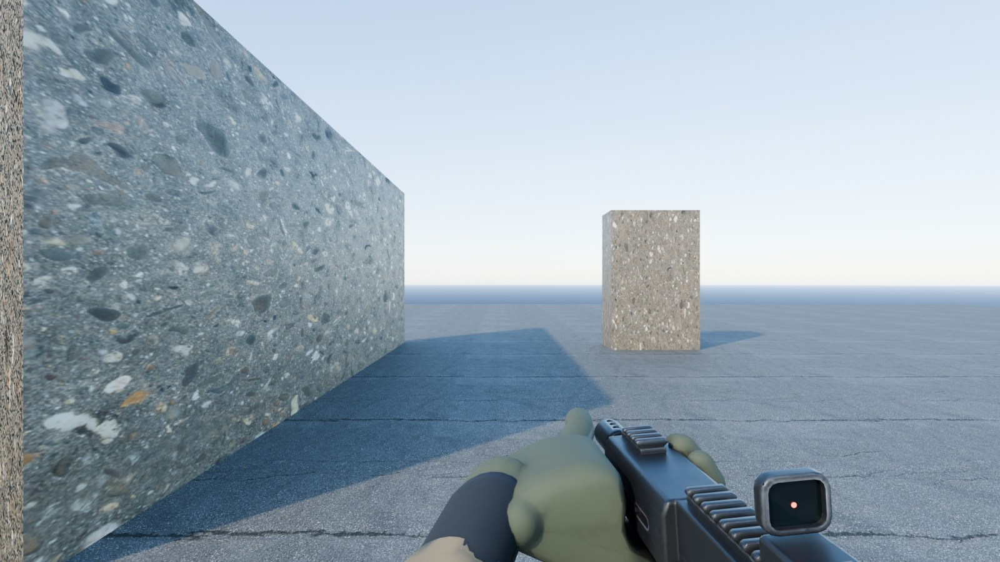
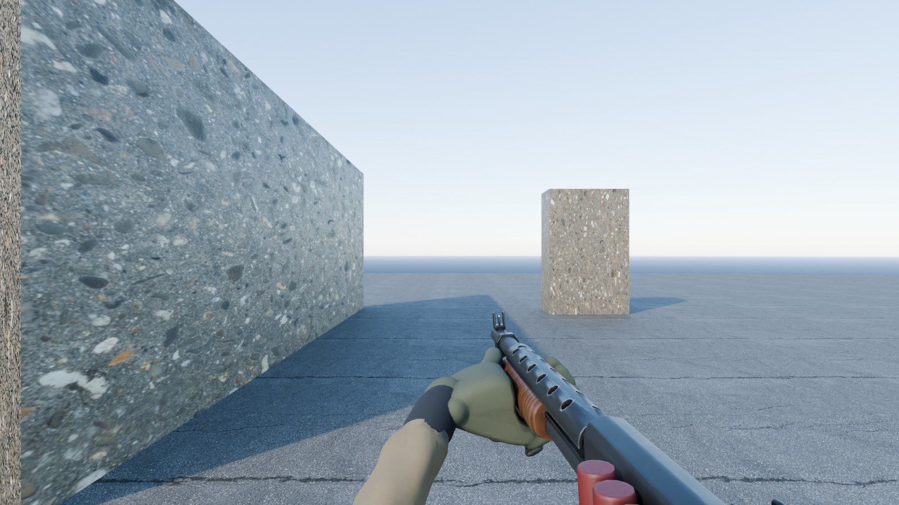
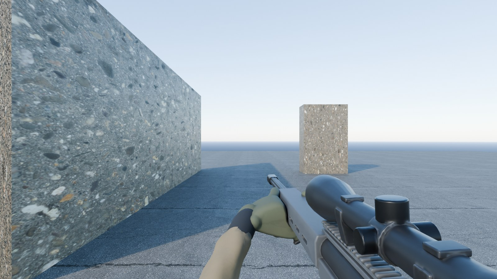
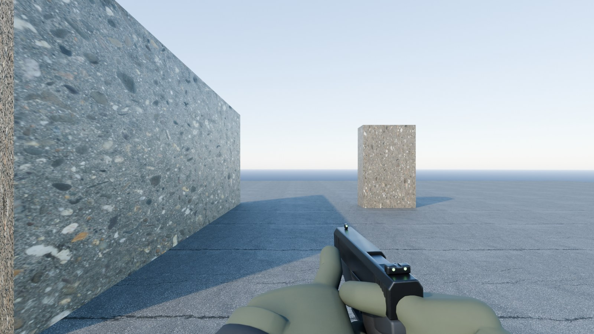
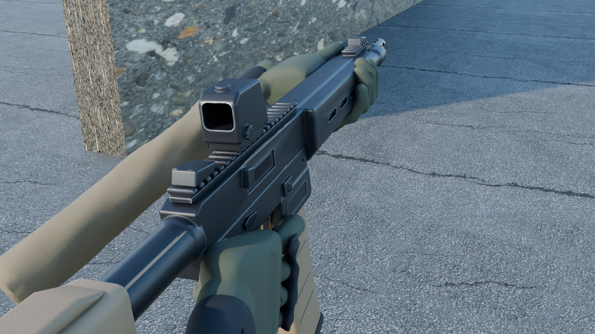
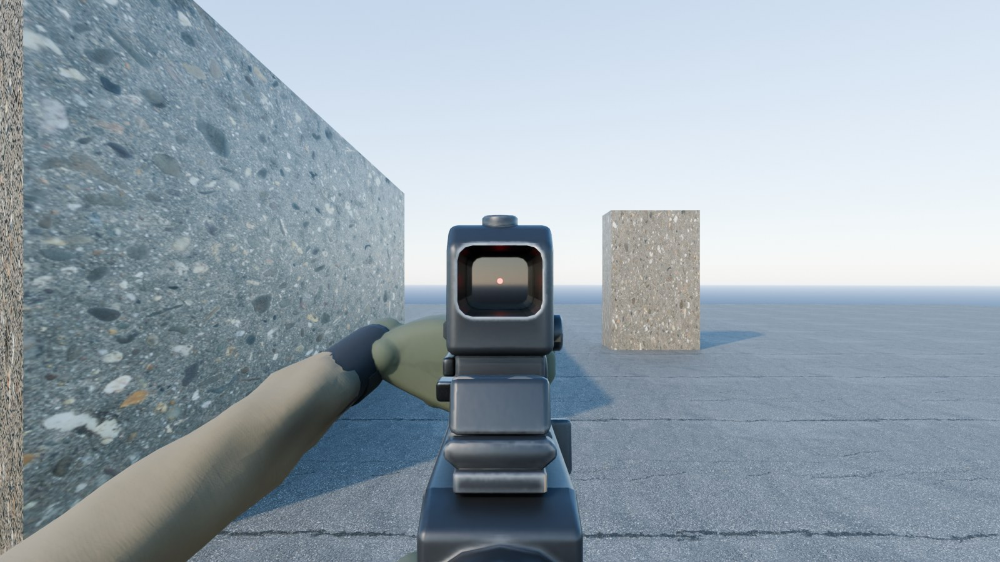

# Weapon and arm art — weapons-v1, October 30, 2026

The first-person overhaul ([design](superpowers/specs/2026-10-30-first-person-combat-overhaul-design.md)) needs guns and gloved hands you look at all match long. `public/models/weapons-v1.glb` holds five firearms, a knife, a frag grenade and a pair of gloved forearms. Every model is an original design built from code in Blender: no scanned or purchased parts, no real-world trademarks, logos or markings. Identity comes from shape and colour.

| Model | What it is | Look |
| --- | --- | --- |
| KR-5 Carbine | Monolithic-upper carbine, free-float slotted handguard, closed reflex sight, weapon light, slotted muzzle brake, curved 30-round magazine | Black hard-anodised metal, tan polymer furniture |
| Hornet 9 | Compact 9 mm carbine with a folding skeleton stock and an open reflex sight | Black metal, ranger-green polymer |
| Breaker 12 | Pump shotgun with a vented heat shield, ghost-ring sights, side shell carrier | Black metal, walnut pump, black polymer stock |
| Longbow | Chassis bolt rifle, fluted heavy barrel, three-port brake, 4x-class scope | Tungsten-grey chassis, black scope |
| Sentry 9 | Polymer-frame service pistol, serrated slide, glowing night sights | Black frame and slide |
| Knife | Fixed blade, coated drop point with a bright edge | Black blade, tan grip |
| Frag | Ovoid fragmentation grenade with spoon and pull ring | Olive drab with a faded yellow band |
| Arms | Gloved hands with moulded knuckle guards, neoprene cuffs with straps, ripstop sleeves | Ranger-green gloves, coyote sleeves |



## How it looks in first person

These are Blender Cycles renders of the shipped textures from the first-person camera (80° horizontal field of view) in a plain street with late-afternoon sun. At the hip the camera sees each weapon's **left side and top**, so that side carries the most detail (the KR-5's charging handle is on the left for that reason).

| | |
| --- | --- |
|  |  |
|  |  |
|  |  |
|  | |

Three.js lighting differs from these renders. Metals need an environment map (`scene.environment`) to read as metal; check the final look in the game.

## The GLB contract

Everything here is what the viewmodel (`src/game/WeaponModels.ts`, `src/game/ViewModel.ts`) and the remote-player weapon socket can rely on. `node scripts/blender/validate_weapons.mjs` checks all of it.

**Units and axes.** Metres. glTF −Z is forward (toward the muzzle), +Y up, +X to the shooter's right.

**Loading.** The file requires `EXT_meshopt_compression`, `KHR_mesh_quantization` and `KHR_texture_basisu`: use `GLTFLoader` with `setMeshoptDecoder(MeshoptDecoder)` and `setKTX2Loader(...)`, like the town.

**Roots.** The scene has exactly nine root nodes, all at the origin and unrotated: `weapon_kr5`, `weapon_hornet9`, `weapon_breaker12`, `weapon_longbow`, `weapon_sentry9`, `knife`, `frag`, `arm_left`, `arm_right`. Root extras carry `model` (the id) and, for firearms, `boreHeight` and `sightHeight` (metres above the palm grip point) and `trigger` (where the index finger meets the trigger, in the weapon's own glTF space); the arms carry `heldAxis`. `art/source/weapons/weapons-build.json` lists every anchor's translation and rotation.

**Names in three.js.** `GLTFLoader` makes node names unique across the whole file, so the second weapon's `mag` arrives as `mag_1`. Match nodes by `userData.name` (the original glTF name, which `GLTFLoader` keeps) or by the extras below, never by `object.name`.

**Firearm origin.** A weapon's origin is the **right palm grip point**: the centre of the fist on the pistol grip. `grip_r` sits exactly there. Attaching a weapon root to a hand socket at the palm therefore puts the grip in the hand with no offset.

**Firearm children.**

| Node | Kind | Meaning |
| --- | --- | --- |
| `body` | mesh | Everything that does not move. Primitives: the weapon's baked material (`W_weapon_<id>`), plus `WeaponLens` (dark coated glass) and `WeaponGlowRed` / `WeaponGlowGreen` (emissive reticle dot, tritium sights) where the weapon has them. |
| `mag` | pivot (`extras.part = "mag"`) with mesh child `mag_mesh` | Origin at the top centre of the magazine where it seats in the well. Pull it out along the pivot's local −Y (the pistol's pivot is tilted to its grip angle). **Breaker 12:** one shell sitting just inside the loading port, pivot at its brass head, nose toward −Z — the per-shell reload pushes it in along −Z. |
| `action` | pivot (`extras.part = "action"`) with mesh child `action_mesh` | Pivot on the bore axis. KR-5: left-side charging handle, pulls back along +Z about 0.06 m. Hornet 9: top-rear T-handle, +Z about 0.05 m. Breaker 12: walnut pump, +Z about 0.09 m. Longbow: bolt and handle — rotate about local Z by about +60° (handle up), then slide +Z about 0.09 m. Sentry 9: the slide, +Z about 0.022 m per shot and locked back on empty. |
| `grip_r` | empty (`extras.anchor`) | Right palm grip point, always the origin. Its **rotation seats `arm_right`**. |
| `grip_l` | empty | Support-hand palm point on the handguard, pump or fore-end (on the Sentry 9: wrapped round the firing hand). Its **rotation seats `arm_left`**. |
| `muzzle` | empty | Bore exit, for flash, smoke and tracers. |
| `sight` | empty | A point on the optical axis; aiming puts the eye on the line through it along −Z. KR-5 and Hornet 9: the reticle dot on the lens. Breaker 12: the rear aperture centre (front post tip on the line). Longbow: the ocular lens. Sentry 9: the rear notch (front sight tip on the line). |
| `eject` | empty | Case exit at the right-side ejection port. |

**Seating the arms.** Add each arm root as a child of its anchor with an identity local transform: `anchors.gripRight.add(arms.right)` and `anchors.gripLeft.add(arms.left)`. The anchor rotation already wraps the fist round the grip or handguard and sends the forearm back toward the shooter (right forearm back, out and slightly down; left forearm back, left and down). Weapon tilt, recoil and reload motion then carry the hands with the gun.

**Arms.** `arm_left` and `arm_right` each have one mesh child, `arm`: glove, knuckle guard, cuff and sleeve in one baked material. The origin is the palm grip point (the centre of the closed fist), the forearm runs toward +Z for about 0.4 m and the far end is closed. `extras.heldAxis` is the direction of the object the fist closes round, in arm space. The right index finger rests on the trigger (it reaches the trigger of every firearm because each trigger is placed from the hand); the left hand wraps a 52 mm round handguard with its thumb along the upper left side.

**Knife and frag.** The knife's origin is the palm grip point on its handle, blade toward −Z, edge down; it also carries a `grip_r` anchor that seats `arm_right` with the back of the hand to the right. The frag's origin is the centre of its body; the spoon is on +X and the pull ring on −X.

## Materials and textures

Procedural surfaces are designed in Blender and baked per model into three maps on one UV atlas:

- **Base colour** (sRGB): finish colour with broad tonal variation, worn bare metal on exposed edges (found with a wide bevel-normal mask), scratches on metal, and grime and cavity darkening from short-range occlusion.
- **ORM** (linear): ambient occlusion in red, roughness in green, metal in blue. Anodised and painted finishes are non-metal with metal edges where they are worn through.
- **Normal** (tangent space, OpenGL +Y): small rounding on every edge plus surface relief — stippled grips, cast polymer, satin and brushed metal, textured rubber, glove knit and pebbled leather with a stitched seam, ripstop weave with creases.

Meshes are triangulated before unwrapping and exported with tangents, so the baked tangent space matches the file. Finishes: hard-anodised black, tungsten-grey Cerakote, phosphate and nitride steel, flat dark earth, black and ranger-green polymer with stippled grip panels, walnut, rubber, brass, red shell hulls, olive drab paint, coated blade steel, glove knit with synthetic-leather palms, knuckle-guard foam, neoprene, hook tape and ripstop.

Lenses (`WeaponLens`) and glows (`WeaponGlowRed`, `WeaponGlowGreen`) are small untextured materials. The finish step sets the glow strengths for three.js tone mapping (red dot 2.2, night sights 1.6) so the dot stays red instead of clipping to white.

## Budgets and measured cost

| Model | Triangles | Budget | Colour / normal / ORM texture | KTX2 bytes |
| --- | ---: | ---: | --- | ---: |
| KR-5 | 11,214 | 12,000 | 2048 / 2048 / 1024 | 985,801 |
| Hornet 9 | 7,210 | 12,000 | 1024 / 1024 / 512 | 348,042 |
| Breaker 12 | 6,612 | 12,000 | 1024 / 1024 / 512 | 330,962 |
| Longbow | 10,548 | 12,000 | 1024 / 1024 / 512 | 363,908 |
| Sentry 9 | 2,568 | 12,000 | 1024 / 1024 / 512 | 267,150 |
| Knife | 978 | 3,000 | 512 / 512 / 256 | 82,970 |
| Frag | 1,426 | 3,000 | 512 / 512 / 256 | 85,061 |
| Left arm | 7,028 | 8,000 | 1024 / 1024 / 512 | 260,375 |
| Right arm | 7,028 | 8,000 | 1024 / 1024 / 512 | 261,803 |

The file is **3,735,812 bytes** against the 6,000,000-byte budget: 2.99 MB of KTX2 (ETC1S) textures and 0.75 MB of Meshopt geometry and scene data. SHA-256 `fb0c73a34827b01a5c2f4fe10fb4cca5f786df7656644eb1259660a05e0aeafa` (also in `art/source/weapons/weapons-v1-manifest.json`).

In first person a weapon with both arms is 16,600–25,300 triangles and 5 or 6 draw calls (body, magazine and action meshes, lens and glow where present, one per arm). A one-off check in headless Chromium with three.js r185 (`GLTFLoader` + `KTX2Loader` + `MeshoptDecoder`) loaded the file without errors, and arms seated with `anchor.add(arm)` landed on every grip, handguard and pump exactly as in the Blender previews.

## Regenerate

Use Blender **5.2.1 LTS**, Node.js 24+ and KTX-Software 4.4 (`ktx` on PATH or `KTX_BIN`; the default is `C:\it\tools\ktx\bin`). From the repository root:

```powershell
npm run weapons:generate   # build, unwrap, bake, export the raw GLB to %TEMP%\kannon-weapons-v1, render previews (about 15 minutes)
npm run weapons:finish     # KTX2 textures, Meshopt geometry, contract names and extras -> public/models/weapons-v1.glb
npm run weapons:validate   # contract, anchors, sight lines, hand wrap, bounds, budgets
```

The scripts are `scripts/blender/generate_weapons.py` (run through `scripts/blender/run_blender.mjs`), `scripts/blender/finish_weapons.mjs` and `scripts/blender/validate_weapons.mjs`. Working files (raw GLB, baked PNGs, `.blend`) go to the system temp folder (`--work` changes it) and are never committed. Committed outputs are the GLB, `art/source/weapons/weapons-build.json` (anchors and triangle counts), `art/source/weapons/weapons-v1-manifest.json` (bytes, SHA-256, textures) and the preview images.

For look development, render straight from the procedural materials without baking:

```powershell
node scripts/blender/run_blender.mjs --python scripts/blender/generate_weapons.py -- --stage look --only kr5,arm_left,arm_right --views fp-kr5-hip,over-kr5,side-kr5
```

Views: `fp-<id>-hip`, `fp-<id>-ads`, `over-<id>`, `under-<id>`, `hands-r-<id>`, `hands-l-<id>`, `side-<id>`, `left-<id>`, `back-<id>`, `lineup`. Add `--debug-tris` to list the heaviest parts. To re-render the committed previews from the last bake without baking again, run `--stage previews`.

## Validation

`scripts/blender/validate_weapons.mjs` decodes the shipped file (Meshopt and quantized attributes included) and fails unless:

- the file is a valid glTF 2.0 binary within 6,000,000 bytes, requires Meshopt, mesh quantization and Basis Universal, and has no animations, skins, cameras or lights;
- every image is an embedded KTX2 texture, a power of two within 2048, and every textured material has colour, ORM and normal maps;
- the scene roots are exactly the nine contract roots, untransformed;
- each firearm has `body`, `mag` and `action` (with meshes) and the five anchors with their extras; the origin is the right palm grip point; the muzzle is on the bore at the front; the weapon points along −Z; the sight is above the bore on the centre line; ejection is on the right; the support hand is forward on the fore-end (or wrapped round the firing hand on the pistol); seated forearms point back toward the shooter;
- the sight line is clear from the sight to the muzzle; iron sights put the front post on the line; reflex sights have their glowing dot on the axis; the Longbow's eye position looks straight into its ocular lens;
- lengths, widths and triangle counts stay within limits (12,000 per firearm, 8,000 per arm, 3,000 for the knife and frag);
- each arm's forearm runs toward +Z and its hand closes round the palm grip point (at least 8 of 12 rays across the held axis meet the glove within 6 cm for the firing hand; 7 for the support hand, which leaves the top of the handguard open);
- the manifest's SHA-256 matches the file.

## Provenance

All geometry, materials and textures in the shipped file are original and generated by `scripts/blender/generate_weapons.py`. The look-development backdrop (not shipped) uses the Poly Haven CC0 asphalt and concrete textures already listed in `art/source/town-v2/cc0-manifest.json`. Three.js and its Basis transcoder and Meshopt decoder are MIT-licensed; KTX-Software is Apache-2.0.

## Limitations

- Arms are rigid: one pose per hand and no finger animation. The right index finger rests on the trigger of every firearm; on the knife it lies along the guard.
- Fingers sink a few millimetres into grips by design so no gap ever shows; on the pistol the support fingers overlap the firing hand at the front, out of the first-person camera's view.
- No markings or text (avoids trademarks entirely).
- The occlusion/roughness/metal maps ship at half the colour resolution to stay inside the 6 MB budget.
- The previews are Blender renders, not the game renderer.
