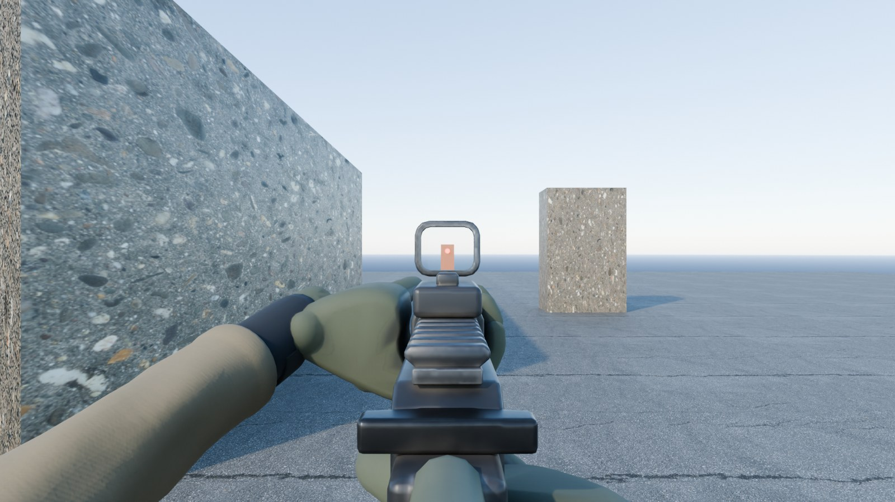
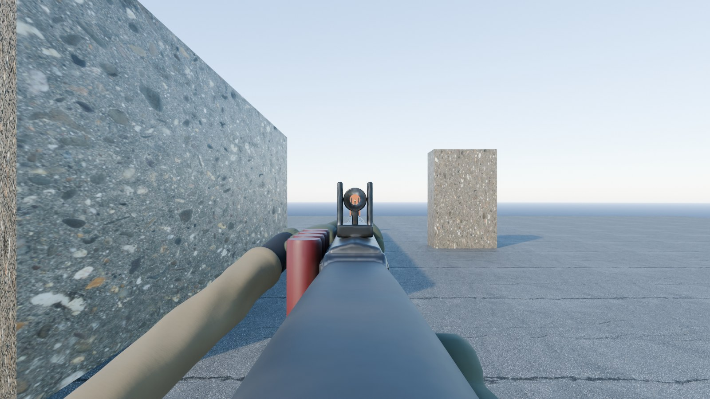
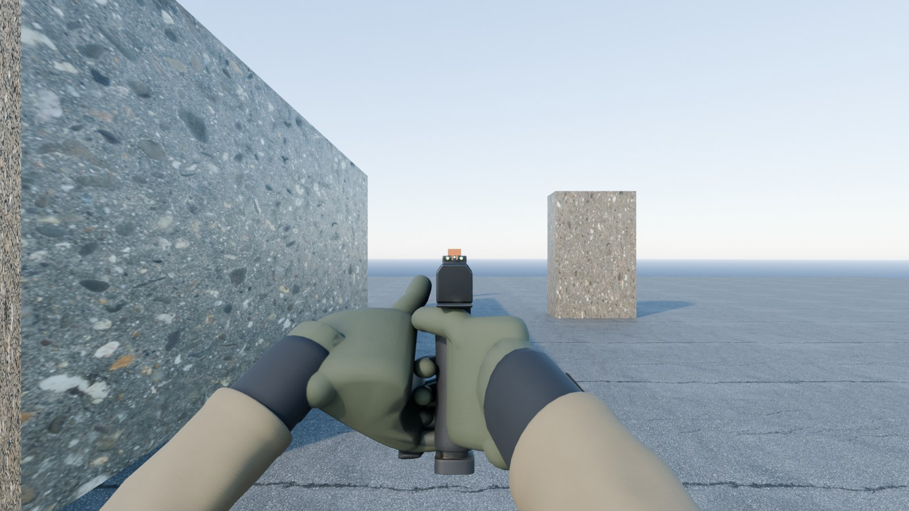
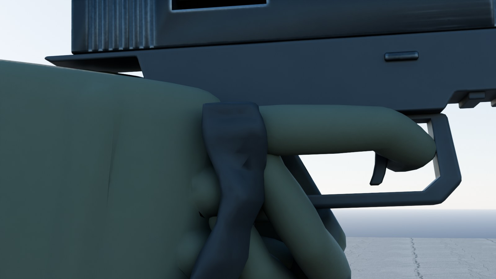
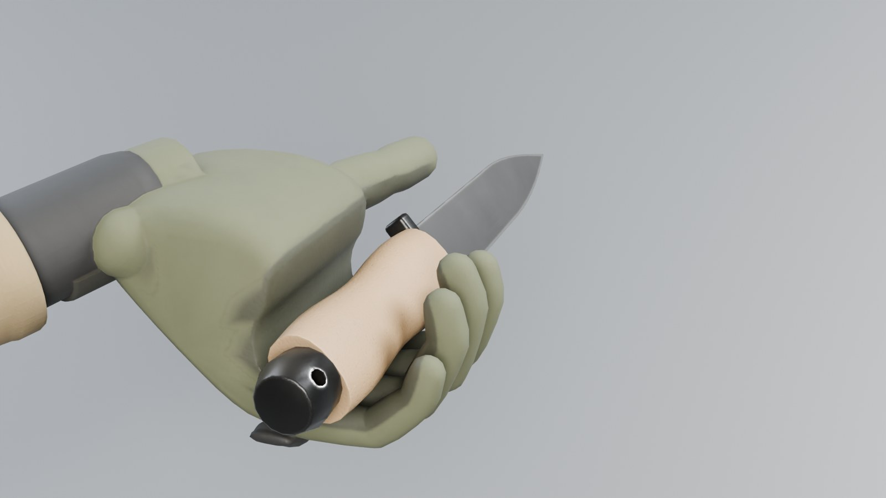

# Weapon and arm art — weapons-v1, October 31, 2026

The first-person overhaul ([design](superpowers/specs/2026-10-30-first-person-combat-overhaul-design.md)) needs guns and gloved hands you look at all match long. `public/models/weapons-v1.glb` holds five firearms, a knife, a frag grenade and a pair of gloved forearms. Every model is an original design built from code in Blender: no scanned or purchased parts, no real-world trademarks, logos or markings. Identity comes from shape and colour.

| Model | What it is | Look |
| --- | --- | --- |
| KR-5 Carbine | Monolithic-upper carbine, free-float slotted handguard, closed reflex sight with a see-through window, weapon light, slotted muzzle brake, curved 30-round magazine | Black hard-anodised metal, tan polymer furniture |
| Hornet 9 | Compact 9 mm carbine with a folding skeleton stock and an open reflex sight | Black metal, ranger-green polymer |
| Breaker 12 | Pump shotgun with a vented heat shield, tall ghost-ring sights, side shell carrier and a moulded skeleton stock | Black metal, walnut pump, black polymer stock |
| Longbow | Bolt rifle in a chassis with a folding skeleton stock (slotted spine, angled strut, cheek riser on posts), fluted heavy barrel, three-port brake, 4x-class scope | Tungsten-grey chassis, black scope |
| Sentry 9 | Polymer-frame service pistol, serrated slide, three-dot night sights with a deep rear notch | Black frame and slide |
| Knife | Fixed blade, coated drop point with a bright edge, chunky stippled grip | Black blade, tan grip |
| Frag | Ovoid fragmentation grenade with spoon and pull ring | Olive drab with a faded yellow band |
| Arms | Gloved hands with tapered, jointed fingers, moulded knuckle guards, neoprene cuffs with straps, ripstop sleeves with a rolled hem | Ranger-green gloves, coyote sleeves |


## How it looks in first person

These are Blender Cycles renders of the shipped textures from the first-person camera (80° horizontal field of view) in a plain street with late-afternoon sun and an orange person-sized target 20 m ahead on the aim line. At the hip the camera sees each weapon's **left side and top**, so that side carries the most detail (the KR-5's charging handle is on the left for that reason). The aimed views put the eye on the sight line 0.22–0.40 m behind the sight anchor.

| | |
| --- | --- |
|  |  |
|  |  |
|  |  |
|  |  |
|  |  |
|  |  |

Three.js lighting differs from these renders. Metals need an environment map (`scene.environment`) to read as metal; check the final look in the game.

## The GLB contract

Everything here is what the viewmodel (`src/game/WeaponModels.ts`, `src/game/ViewModel.ts`) and the remote-player weapon socket can rely on. `node scripts/blender/validate_weapons.mjs` checks all of it.

**Units and axes.** Metres. glTF −Z is forward (toward the muzzle), +Y up, +X to the shooter's right.

**Loading.** The file requires `EXT_meshopt_compression`, `KHR_mesh_quantization` and `KHR_texture_basisu`: use `GLTFLoader` with `setMeshoptDecoder(MeshoptDecoder)` and `setKTX2Loader(...)`, like the town.

**Roots.** The scene has exactly nine root nodes, all at the origin and unrotated: `weapon_kr5`, `weapon_hornet9`, `weapon_breaker12`, `weapon_longbow`, `weapon_sentry9`, `knife`, `frag`, `arm_left`, `arm_right`. Root extras carry `model` (the id) and, for firearms, `boreHeight` and `sightHeight` (metres above the palm grip point) and `trigger` (where the index finger meets the trigger, in the weapon's own glTF space); the arms carry `heldAxis` (glTF axes of the arm's own space). `art/source/weapons/weapons-build.json` lists every anchor's translation and rotation in glTF axes.

**Names in three.js.** `GLTFLoader` makes node names unique across the whole file, so the second weapon's `mag` arrives as `mag_1`. Match nodes by `userData.name` (the original glTF name, which `GLTFLoader` keeps), by the extras below, or by a base-name match that accepts `_1`, `_2` suffixes; never by exact `object.name`.

**Tags.** Every tag value names exactly one node per root. Empties carry `extras.anchor` (`grip_r`, `grip_l`, `muzzle`, `sight`, `eject`, and `hold` on `arm_left`). Only the two moving-part pivots carry `extras.part` (`mag`, `action`). Every mesh carries `extras.mesh` (`body`, `mag`, `action`, `arm`), never `part`, so a search for part `mag` always finds the pivot and never its mesh child.

**Firearm origin.** A weapon's origin is the **right palm grip point**: the centre of the fist on the pistol grip. `grip_r` sits exactly there. Attaching a weapon root to a hand socket at the palm therefore puts the grip in the hand with no offset.

**Firearm children.** All anchors and both pivots are direct children of the weapon root.

| Node | Kind | Meaning |
| --- | --- | --- |
| `body` | mesh | Everything that does not move. Primitives: the weapon's baked material (`W_weapon_<id>`), plus `WeaponReflexGlass` (KR-5, Hornet 9: see-through sight window, blended, alpha 0.16), `WeaponLens` (Longbow only: opaque scope glass) and `WeaponGlowRed` / `WeaponGlowGreen` (emissive reticle dot, tritium sights) where the weapon has them. |
| `mag` | pivot empty (`extras.part = "mag"`) with mesh child `mag_mesh` | Origin at the top centre of the magazine where it seats in the well. Animate the pivot: pull it out along the pivot's local −Y (the pistol's pivot is tilted to its grip angle). **Breaker 12:** one shell sitting just inside the loading port, pivot at its brass head, nose toward −Z — the per-shell reload pushes it in along −Z. |
| `action` | pivot empty (`extras.part = "action"`) with mesh child `action_mesh` | Pivot on the bore axis. KR-5: left-side charging handle, pulls back along +Z about 0.06 m. Hornet 9: top-rear T-handle, +Z about 0.05 m. Breaker 12: walnut pump, +Z about 0.09 m. Longbow: bolt and handle — rotate about local Z by about +60° (handle up), then slide +Z about 0.09 m (the stock and cheek riser stay below and behind its path). Sentry 9: the slide, +Z 0.022 m per shot and locked back on empty; the slide clears both seated hands over that travel. |
| `grip_r` | empty | Right palm grip point, always the origin. Its **rotation seats `arm_right`**. |
| `grip_l` | empty | Support-hand palm point on the handguard, pump or fore-end (on the Sentry 9: wrapped round the firing hand). Its **rotation seats `arm_left`**. **Breaker 12:** `grip_l` marks the pump at rest; when the pump (`action`) slides back, move the left hand by the same travel so it stays on the walnut. |
| `muzzle` | empty | Bore exit, for flash, smoke and tracers. |
| `sight` | empty | A point on the optical axis; aiming puts the eye on the line through it along −Z. KR-5 and Hornet 9: the red dot, just in front of the see-through window. Breaker 12: the rear ghost-ring centre (front post tip on the line). Longbow: the ocular lens. Sentry 9: the top of the rear blade at the notch; the front post's top is level with it, so the front post and its dot sit in the 3 mm notch between the two rear dots. |
| `eject` | empty | Case exit at the right-side ejection port. |

The plan's one-line contract describes `mag` and `action` as "meshes"; in the file they are pivot empties with a mesh child each (see the table). The pivot keeps a clean rest frame for animation, while the mesh child carries the Meshopt dequantization transform.

**Seating the arms.** Add each arm root as a child of its anchor with an identity local transform, or equivalently give the arm the anchor's world position **and world rotation**: `anchors.gripRight.add(arms.right)` and `anchors.gripLeft.add(arms.left)`. The anchor rotation is what wraps the fist round the grip or handguard and sends the forearm back toward the shooter (right forearm back, out and slightly down; left forearm back, left and down); using the weapon root's rotation alone leaves the fists 21–36° off their grips (54° for the pistol's support hand). Weapon tilt, recoil and reload motion then carry the hands with the gun.

**Arms.** `arm_left` and `arm_right` each have one mesh child, `arm`: glove, knuckle guard, cuff and sleeve in one baked material. The origin is the palm grip point (the centre of the closed fist), the forearm runs toward +Z for about 0.4 m and the far end is closed. `extras.heldAxis` is the direction of the object the fist closes round, in the arm's own glTF axes. The right index finger rests on the trigger (it reaches the trigger of every firearm because each trigger is placed from the hand); the left hand wraps a 52 mm round handguard with its thumb along the upper left side.

**Held items.** `arm_left` has an empty `hold` at its palm grip point. A knife added to `hold` with an identity transform sits in the left fist the way a fighting knife is held: handle along the held axis, blade out of the thumb end, edge toward the fingers. A frag added there sits centred in the fist.

**Knife and frag.** The knife's origin is the palm grip point on its handle, blade toward −Z, edge down; it also carries a `grip_r` anchor that seats `arm_right` round the handle (the right hand keeps its trigger-finger pose, so on the knife its index finger points down beside the handle — show the knife in the left hand). The frag's origin is the centre of its body; the spoon is on +X and the pull ring on −X.

## Materials and textures

Procedural surfaces are designed in Blender and baked per model into three maps on one UV atlas:

- **Base colour** (sRGB): finish colour with broad tonal variation, worn bare metal on exposed edges (found with a wide bevel-normal mask), scratches on metal, grime and cavity darkening from short-range occlusion, and a light film of field dust on upward-facing surfaces and packed into crevices (never on the worn edges).
- **ORM** (linear): ambient occlusion in red, roughness in green, metal in blue. Anodised and painted finishes are non-metal with metal edges where they are worn through; dust is rough and non-metal.
- **Normal** (tangent space, OpenGL +Y): small rounding on every edge plus surface relief — stippled grips, cast polymer, satin and brushed metal, textured rubber, glove knit and pebbled leather with a stitched seam, ripstop weave with creases.

Meshes are triangulated before unwrapping and exported with tangents, so the baked tangent space matches the file. Finishes: hard-anodised black, tungsten-grey Cerakote, phosphate and nitride steel, flat dark earth, black and ranger-green polymer with stippled grip panels, walnut, rubber, brass, red shell hulls, olive drab paint, coated blade steel, glove knit with synthetic-leather palms, knuckle-guard foam, neoprene, hook tape and ripstop. The KR-5's weapon-light lens is part of the baked body.

Three small untextured materials remain:

- `WeaponReflexGlass` — the reflex-sight windows. One-sided, blended (`alphaMode: BLEND`, base colour alpha 0.16, a faint blue-green tint). `GLTFLoader` turns it into a transparent material without depth writes, so it draws after the weapon and the target stays fully visible through it. The red dot sits just in front of it.
- `WeaponLens` — opaque dark glass, only on the Longbow's scope (the view model is hidden while scoped).
- `WeaponGlowRed` / `WeaponGlowGreen` — the reticle dot and tritium sights. The finish step sets their glow strengths for three.js tone mapping (red dot 2.2, night sights 1.6) so the dot stays red instead of clipping to white.

## Budgets and measured cost

| Model | Triangles | Budget | Colour / normal / ORM texture | KTX2 bytes |
| --- | ---: | ---: | --- | ---: |
| KR-5 | 11,168 | 12,000 | 2048 / 2048 / 1024 | 1,089,666 |
| Hornet 9 | 7,164 | 12,000 | 1024 / 1024 / 512 | 365,660 |
| Breaker 12 | 8,944 | 12,000 | 1024 / 1024 / 512 | 361,645 |
| Longbow | 10,708 | 12,000 | 1024 / 1024 / 512 | 378,728 |
| Sentry 9 | 2,672 | 12,000 | 1024 / 1024 / 512 | 326,705 |
| Knife | 1,030 | 3,000 | 512 / 512 / 256 | 86,786 |
| Frag | 1,426 | 3,000 | 512 / 512 / 256 | 85,889 |
| Left arm | 7,710 | 8,000 | 1024 / 1024 / 512 | 255,450 |
| Right arm | 7,710 | 8,000 | 1024 / 1024 / 512 | 252,251 |

The file is **3,980,700 bytes** against the 6,000,000-byte budget: 3.20 MB of KTX2 (ETC1S) textures and 0.78 MB of Meshopt geometry and scene data. SHA-256 `784123593bd676fe7655d017172a21ce2b13760738cbb1814eb698e6bbc72643` (also in `art/source/weapons/weapons-v1-manifest.json`).

In first person a weapon with both arms is 18,100–26,600 triangles. Draw calls with both arms (one per primitive): KR-5 and Hornet 9 **7** (body: baked, glass, red dot; magazine; action; two arms), Breaker 12 **6** (body: baked, green dot), Longbow **6** (body: baked, scope glass), Sentry 9 **6** (the slide carries the baked material and the night sights). Remote players use the same models (`weapon(id, 'world')` clones them): a remote KR-5 is about 11,000 triangles in 5 draw calls, so on phones keep remote weapons out of shadow casting.

## Regenerate

Use Blender **5.2.1 LTS**, Node.js 24+ and KTX-Software 4.4 (`ktx` on PATH or `KTX_BIN`; the default is `C:\it\tools\ktx\bin`). From the repository root:

```powershell
npm run weapons:generate   # build, unwrap, bake, export the raw GLB to %TEMP%\kannon-weapons-v1, render previews (about 13 minutes)
npm run weapons:finish     # KTX2 textures, Meshopt geometry, contract names, tags and glass -> public/models/weapons-v1.glb
npm run weapons:validate   # contract, tags, anchors, sight pictures, seated hands, slide clearance, bounds, budgets
```

The scripts are `scripts/blender/generate_weapons.py` (run through `scripts/blender/run_blender.mjs`), `scripts/blender/finish_weapons.mjs` and `scripts/blender/validate_weapons.mjs`. Working files (raw GLB, baked PNGs, `.blend`) go to the system temp folder (`--work` changes it) and are never committed. Committed outputs are the GLB, `art/source/weapons/weapons-build.json` (anchors, triangle counts and the glass material), `art/source/weapons/weapons-v1-manifest.json` (bytes, SHA-256, textures) and the preview images.

The arms are built before the guns: the Sentry 9 measures the seated right hand and sets its bore height so the slide's underside clears the web of the hand (with a thin frame tang between them).

For look development, render straight from the procedural materials without baking:

```powershell
node scripts/blender/run_blender.mjs --python scripts/blender/generate_weapons.py -- --stage look --only kr5,arm_left,arm_right --views fp-kr5-hip,over-kr5,side-kr5
```

Views: `fp-<id>-hip`, `fp-<id>-ads`, `over-<id>`, `under-<id>`, `hands-r-<id>`, `hands-l-<id>`, `side-<id>`, `left-<id>`, `back-<id>`, `hold-knife`, `grip-knife`, `lineup`. Add `--debug-tris` to list the heaviest parts. To re-render the committed previews from the last bake without baking again, run `--stage previews`.

## Validation

`scripts/blender/validate_weapons.mjs` decodes the shipped file (Meshopt and quantized attributes included) and fails unless:

- the file is a valid glTF 2.0 binary within 6,000,000 bytes, requires Meshopt, mesh quantization and Basis Universal, and has no animations, skins, cameras or lights;
- every image is an embedded KTX2 texture, a power of two within 2048, and every textured material has colour, ORM and normal maps; `WeaponReflexGlass` is blended with an alpha between 0.05 and 0.35, untextured and one-sided; every other material is opaque;
- the scene roots are exactly the nine contract roots, untransformed, and none of them holds a mesh;
- every tag value names one node per root: `anchor` on empties, `part` only on the `mag` and `action` pivots (each holding `mag_mesh` / `action_mesh`), `mesh` on every mesh;
- each firearm has `body` and the five anchors as direct children of the root; the origin is the right palm grip point; the muzzle is on the bore at the front; the weapon points along −Z; the sight is above the bore on the centre line; ejection is on the right; the support hand is forward on the fore-end (or wrapped round the firing hand on the pistol);
- with both arms seated on their anchors, the forearms point back toward the shooter, the firing fist holds an upright grip that fills it (11 of 12 rays across the seated held axis meet the grip within 32 mm), the support fist holds a fore-end along the bore that fills it (10 of 12 within 40 mm; on the pistol, the grip and firing hand within 50 mm), and the gloves close round both points;
- on the Sentry 9, no vertex of either seated glove lies inside the slide anywhere along its 22 mm travel;
- the sight picture works from the eye: on reflex sights, rays parallel to the bore 2–6 mm off the axis cross nothing but see-through glass, the window holds glass, and the red dot is the first thing on the axis; on iron sights, the line just above the front sight is clear, rays 0.5–2 mm under it pass the rear notch or ring and stop on the front post, light shows on both sides of the post, and every glowing dot is visible from the eye; on the Longbow the eye looks straight into the ocular lens;
- lengths, widths and triangle counts stay within limits (12,000 per firearm, 8,000 per arm, 3,000 for the knife and frag);
- each arm's forearm runs toward +Z and its hand closes round the palm grip point (at least 8 of 12 rays across the held axis meet the glove within 6 cm for the firing hand; 7 for the support hand, which leaves the top of the handguard open); the knife's handle fills the right fist on its `grip_r` anchor and the left fist on `hold`, blade along the held axis;
- the manifest's SHA-256 matches the file.

## Provenance

All geometry, materials and textures in the shipped file are original and generated by `scripts/blender/generate_weapons.py`. The look-development backdrop (not shipped) uses the Poly Haven CC0 asphalt and concrete textures already listed in `art/source/town-v2/cc0-manifest.json`. Three.js and its Basis transcoder and Meshopt decoder are MIT-licensed; KTX-Software is Apache-2.0.

## Limitations

- Arms are rigid: one pose per hand and no finger animation. The right index finger rests on the trigger of every firearm; on the knife it points down beside the handle, so the knife is meant to be shown in the left hand (`hold`).
- The gloved fist is a rifle grip, so on the pistol the web of the hand sits high: the Sentry 9's bore sits 67 mm above the palm grip point (16 mm higher than in the first version) so the slide clears the hand, which makes its frame look taller than a typical service pistol's.
- Fingers sink a few millimetres into grips by design so no gap ever shows; on the pistol the support fingers overlap the firing hand at the front, out of the first-person camera's view.
- No markings or text (avoids trademarks entirely).
- The occlusion/roughness/metal maps ship at half the colour resolution to stay inside the 6 MB budget.
- One detail level: remote players use the first-person models.
- The previews are Blender renders, not the game renderer.
